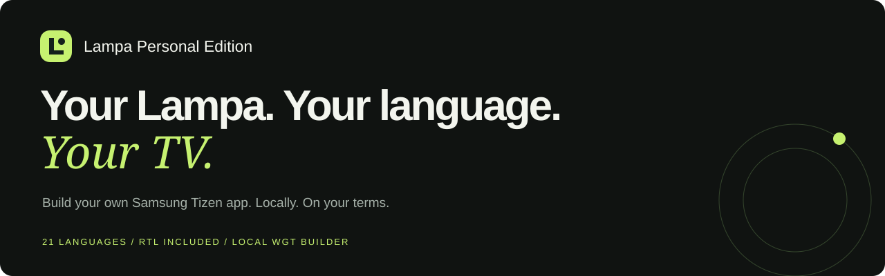
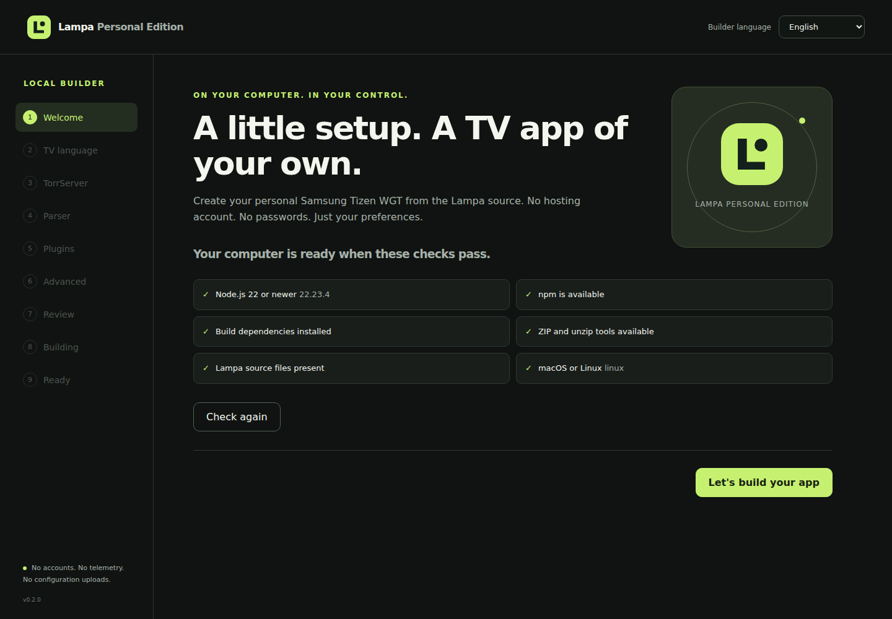
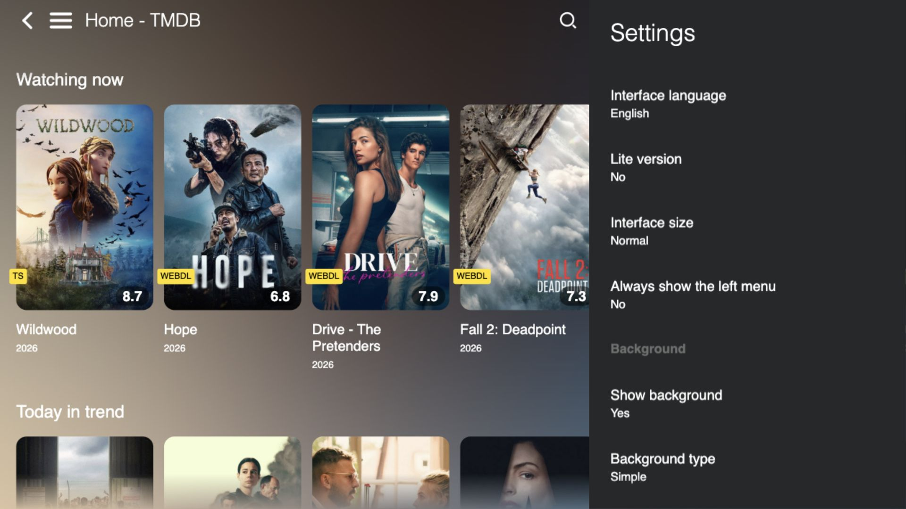

<p align="center"></p>

<p align="center"><a href="#build-your-wgt"><b>Build Your WGT</b></a> · <a href="#explore-the-experience">Explore Features</a> · <a href="docs/INSTALLATION.md">Installation Guide</a> · <a href="https://github.com/vbrekher/lampa-personal-edition">View on GitHub</a></p>

Build your own Samsung Tizen app locally. Choose your language, configure TorrServer, review plugin preferences, and create a personal WGT — **without hosting Lampa yourself**.

**Product Experience 2.0 · v0.2.0 developer preview.** A real local compiler with a visual guide. Physical Samsung certification has not been performed. This is an independent community project, not an official Samsung or Lampa release.

| 21 Languages | Local-First Builder | Samsung Tizen WGT | Personal Configuration |
|---|---|---|---|
| Complete dictionaries, native names and RTL for Arabic, Urdu and Hebrew. | Preferences stay on your computer; no account or configuration upload. | Locally compiled application, translations, fonts and assets. | Your initial TV language, optional TorrServer, parser and plugin policy. |

## Build your WGT

Install **Node.js 22+**, npm, `zip` and `unzip`. macOS and Linux are the supported Builder test platforms; Windows is not verified.

```bash
git clone https://github.com/vbrekher/lampa-personal-edition.git
cd lampa-personal-edition
npm ci
npm run builder
```

Your browser opens the local Builder at **`http://127.0.0.1:<port>`**. If it does not open automatically, follow the address printed in your terminal. The port is selected locally; no external server is required.

1. Check your environment and choose a TV language.
2. Add a TorrServer address **or skip it**. Select your parser and plugin preferences.
3. Review the configuration and build. Watch the actual compiler stages.
4. Download `Lampa-Personal-Edition.wgt`, verify its SHA-256, and follow the [installation guide](docs/INSTALLATION.md).

The wizard can be cancelled and retried. Failed or cancelled builds preserve your previous successful WGT. The package is **unsigned** and has not been installed on the TV automatically.

<p align="center"></p>

[Quick Start](docs/QUICK_START.md) · [Builder Guide](docs/BUILDER_GUIDE.md) · [Troubleshooting](docs/TROUBLESHOOTING.md) · [FAQ](docs/FAQ.md)

## Explore the experience



*Real compiled Lampa interface, captured in a desktop browser at a TV-shaped resolution. This is not a photograph of a Samsung device. Catalogue imagery belongs to its respective owners; live catalogue and playback availability vary.*

The app keeps Lampa's familiar catalogue, movie/series details, search, settings, player and extension catalogue. This edition adds a local personal-build workflow and a separate Tizen application ID, so it can coexist with upstream Lampa.

The [static product page](site/) uses the same visual identity. Its [interactive wizard preview](site/demo/) demonstrates the interface; it **cannot compile a WGT**. Preview both locally:

```bash
npm run site:prepare
npm run site:preview
```

Open the printed local address. The Pages-ready site needs no backend; [publishing instructions](docs/PRODUCT_SITE.md) describe the included GitHub Pages workflow. Public hosting serves only the product page and preview, never the local compiler or your WGT.

## Your language, from the first screen

All **21 languages are inside every WGT**. The choice in the wizard is the initial TV interface language, not a separate language pack. Change it later in TV Settings without rebuilding.

Dutch · German · Turkish · English · Simplified Chinese · Hindi · Spanish · Arabic · French · Bengali · Portuguese · Indonesian · Urdu · Russian · Ukrainian · Belarusian · Bulgarian · Czech · Hebrew · Polish · Romanian

Arabic, Urdu and Hebrew include shared RTL layout and direction-aware navigation. Technical addresses remain left-to-right; posters, video and caption content are not globally mirrored. Licensed local fonts cover the supported scripts.

The **Builder interface** is separately available in **English, Russian and Dutch**. TV metadata preferences remain independent: a fresh install seeds the initial metadata language; existing TV preferences are preserved. Change metadata/search/audio/subtitle preferences inside Lampa Settings.

[Localization architecture](docs/LOCALIZATION.md) · [Improve a Translation](docs/LOCALIZATION_GUIDE.md)

## How a personal WGT is made

**Choose → compile locally → apply configuration → create archive → verify → install separately.**

The visual wizard and `npm run build:personal` use one shared API in `personal/engine.mjs`, the existing Gulp pipeline and common settings normalization. The package contains the locally compiled application instead of a remote main-app loader. All 21 dictionaries and local font bytes are checked before packaging. The completed WGT is published atomically to `dist/`; concurrent CLI/UI builds in the same checkout are locked out.

<details><summary><b>Prefer the terminal?</b> The CLI remains available.</summary>

```bash
npm run build:personal -- --language nl --parser jackett --plugins off
npm run build:personal -- --language en --torrserver http://192.168.1.100:8090 --parser prowlarr --plugins off
npm run build:personal -- --builder-language ru --language ar --plugins off
```

Without app-setting flags, the CLI keeps its interactive terminal setup. `--builder-language` selects terminal messages; `--language` selects the TV's initial interface language. Personal packages are written locally and must not be committed or uploaded.

</details>

## Your TorrServer and parser

TorrServer runs **separately**, on your network. The WGT does not include a torrent server. An empty address is a supported build configuration. You can edit server and parser settings on the TV later.

| Mode | What you provide |
|---|---|
| Jackett | A separately configured Jackett service and compatible indexers. |
| Prowlarr | Your own Prowlarr service and indexer configuration. |
| TorrServer | Your server and Lampa's existing TorrServer parser mode. |

Selecting a mode does not provide a working service, indexer, media source or subscription. The Builder accepts HTTP(S) addresses without credentials, query strings or fragments. It does not contact the entered address. No passwords or secret tokens are requested.

## Extensions without silent consent

The built-in catalogue remains visible even with plugins disabled. **Catalogue availability and permission to run third-party JavaScript are separate choices.** Plugins are disabled by default.

Enabling third-party plugins in the wizard requires an explicit acknowledgement. The build does not install or execute plugins. Each new third-party installation still requires the existing confirmation on the TV. Plugin code can access app data and contact external services; provider availability is independent of this project.

## Install on your TV

Use [Apps2Samsung](https://github.com/Apps2Samsung/Apps2Samsung/releases) → **Custom WGT** and select your local file. Follow its certificate or re-signing instructions and your TV's Developer Mode requirements. Signing, installation and playback depend on the model, firmware, network and your own configured services.

The WGT targets **Tizen TV 5.0+**. That manifest requirement is a target, not hardware certification. The separate application ID is `L4mpaPers0.LampaPersonal`.

[Full Installation Guide](docs/INSTALLATION.md) · [Compatibility Matrix](docs/COMPATIBILITY.md)

## Privacy and local control

- The Builder listens only on `127.0.0.1`; Host, Origin, cookie and per-process token checks protect its API.
- Configuration lives in the current tab and local output. There is no telemetry, account, cloud compiler or configuration upload.
- The API exposes the current build artifact only, not arbitrary local files or shell commands.
- Closing the terminal stops the server; graceful shutdown cancels active work and removes temporary files.
- The **installed TV app** can contact metadata providers and services you choose. Plugins have their own network behaviour.
- Do not share a personal WGT: it contains your chosen configuration.

## Community

**[Improve a Translation →](docs/LOCALIZATION_GUIDE.md)**

A better phrase, an RTL fix or a clearer label helps the next person feel at home. Focused translation changes use fast automatic checks and targeted screenshots when relevant; you do not need to repeat the entire 21-language visual matrix for a few words.

[Contribution Guide](CONTRIBUTING.md) · [Translation PR template](.github/PULL_REQUEST_TEMPLATE/translation.md) · [Report a problem](https://github.com/vbrekher/lampa-personal-edition/issues)

## Documentation and support

| Get started | Go deeper |
|---|---|
| [Quick Start](docs/QUICK_START.md) | [Builder Guide](docs/BUILDER_GUIDE.md) |
| [Installation Guide](docs/INSTALLATION.md) | [Compatibility Matrix](docs/COMPATIBILITY.md) |
| [Troubleshooting](docs/TROUBLESHOOTING.md) | [Localization Guide](docs/LOCALIZATION_GUIDE.md) |
| [FAQ](docs/FAQ.md) | [Developer Contribution Guide](CONTRIBUTING.md) |
| [Russian guide](docs/README.ru.md) | [Dutch guide](docs/README.nl.md) |

[Source code](https://github.com/vbrekher/lampa-personal-edition) · [Releases](https://github.com/vbrekher/lampa-personal-edition/releases) · [Release notes](CHANGELOG.md)

## Built on Lampa

Thanks to [Yumata / Lampa Source](https://github.com/yumata/lampa-source), its authors and contributors. Original Lampa functionality, copyright and license notices remain. This fork is independent and is not endorsed by Samsung, Apps2Samsung or the upstream maintainers.

The repository contains a GPL v2 `LICENSE`, while upstream package metadata declares ISC. This pre-existing inconsistency remains documented pending upstream clarification; this PR does not relicense the original application. New community work must respect the original attribution and applicable licenses.
