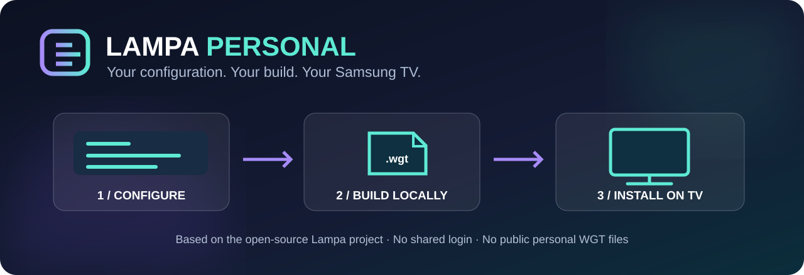

<h1 align="center">Lampa Personal Edition</h1>

A personal Samsung Tizen build of the Lampa movie &amp; TV catalogue, made on your own computer.

  

<a href="#quick-start">Quick Start</a> · <a href="docs/README.ru.md">Russian guide</a> · <a href="docs/README.nl.md">Dutch guide</a> · <a href="docs/INSTALLATION.md">Install guide</a> · <a href="docs/TROUBLESHOOTING.md">Troubleshooting</a>

---

**Lampa Personal Edition** is an independent community fork of [Lampa by Yumata](https://github.com/yumata/lampa-source). The goal is simple: customize the app *on your Mac or Linux computer* instead of entering server URLs and settings with a Samsung TV remote.

The personal builder compiles Lampa from source, packages its HTML/CSS/JavaScript in a **local Tizen WGT**, and preconfigures your selected language and optional TorrServer address while retaining editable Parser and TorrServer settings on the TV. It uses a **different Tizen application ID**, so it can coexist with an existing Lampa installation.

> **Current status — developer preview (v0.1.0).** The build pipeline has automated tests, but Samsung installation and end-to-end playback have **not yet been verified on a physical TV**. This is not a production-certified TV release.

## Highlights

| Your own settings | Self-contained app code | Separate app identity |
| --- | --- | --- |
| Choose language, optional TorrServer URL and plugin policy on your computer | The WGT contains locally compiled Lampa assets rather than fetching the main app from an external loader | Install alongside upstream Lampa; configure or remove it independently |

**No Lampa hosting required.** You can browse Lampa's movie/TV catalogue without running a personal Lampa application server. The app may still contact remote catalogue, metadata and other providers. It is **not an offline movie collection**, and the WGT does **not** contain films, streams, TorrServer, a VPN or third-party content.

## In-app localization

The 13-language localization expansion is currently **in progress**, not complete: Dutch, German and Turkish are priority languages, joined by the ten most-spoken languages worldwide. Existing English, Chinese, Spanish, French and Portuguese now have complete canonical translation-key coverage (native-language editorial review remains separate); the eight additional locales are in translation drafts and are **not displayed as finished TV languages**. The curated plugin catalogue has translated categories and descriptions for all 13 languages. See the [localization coverage audit and acceptance criteria](docs/LOCALIZATION.md). Run `npm run i18n:report` to inspect real string coverage before publishing a language. No unfinished translation is substituted silently for a completed pack.

## Quick Start

Requirements: **macOS or Linux**, Node.js 22+ and npm, `zip`, `unzip`, and an internet connection during dependency installation.

~~~bash
git clone https://github.com/vbrekher/lampa-personal-edition.git
cd lampa-personal-edition
npm install
npm run build:personal
~~~

The builder will ask for:

~~~text
Lampa interface language [ru/en/uk/fr/es/pl] (Enter=en):
TorrServer URL (optional; Enter to skip):
Parser backend [jackett/prowlarr/torrserver] (Enter=jackett):
Enable third-party plugins? [y/N]:
~~~

Press Enter to accept the defaults for all four questions. The default English builder selects the English TV interface. The default build has **no TorrServer URL, no account credentials and no installed third-party plugins**. The optional plugin catalogue is visible, but installing a plugin requires a user action and the first installation requires explicit consent. It never asks for your CUB account/password.

The **builder's terminal language** is separate from the **Lampa TV interface language**. The terminal defaults to English; use `--builder-language ru` or `--builder-language nl` for Russian or Dutch setup messages. Lampa does not yet provide a Dutch TV interface, so Dutch setup defaults the TV interface to English.

Want a non-interactive build? For example:

~~~bash
npm run build:personal -- --language en --plugins off
~~~

The resulting file is:

~~~text
dist/Lampa-Personal-Edition.wgt
~~~

Install through [Apps2Samsung](https://github.com/Apps2Samsung/Apps2Samsung) → **Custom WGT**. Apps2Samsung can handle signing/re-signing where supported. See the [complete TV installation guide](docs/INSTALLATION.md).

## What can be configured?

| Setting | Default | Notes |
| --- | --- | --- |
| TV interface language | `en` (English builder) | Supported upstream: ru, en, uk, be, zh, pt, bg, he, cs, ro, fr, pl, es |
| TorrServer URL | empty | Your own reachable `http://192.168.x.x:8090` or HTTPS endpoint; optional. Parser and Server menus are visible even when empty. |
| Third-party plugins | disabled | Six source-reviewed links appear in an offline categorized catalogue. Explicit user installation/consent is required before third-party code runs. |
| Lampa account login | not bundled | No username, password, CUB cookie or tokens embedded |
| App identity | `L4mpaPers0.LampaPersonal` | Separate from the original Lampa app |
| App source | local WGT assets | No `loader.js` fetching updated application JS at launch |

The builder seeds language and TorrServer URL on first launch, or when those builder inputs change in a new WGT. **TV-side edits persist across ordinary restarts.** You can fill in the missing TorrServer/Parser settings directly from the TV after installing, without rebuilding. To change builder defaults for a new personal package, rebuild and reinstall. TorrServer itself must run separately and be reachable from the TV; this project does not run torrent engines on Tizen.

## Compatibility

Upstream Lampa includes Samsung Tizen support; this personal adapter targets **Tizen 5.0+**, but it has not yet been proven on each Samsung model. The original Lampa features, media decoding, HLS/AVPlay behavior and supported codecs depend on TV firmware, server and network. **Samsung UE43DU7100UXUA / Tizen 9 remains a test target, not a verified result for this Lampa fork.**

## Documentation

| Goal | Guide |
| --- | --- |
| Full installation walkthrough | [Installation](docs/INSTALLATION.md) |
| Russian-language instructions | [Russian guide](docs/README.ru.md) |
| Dutch-language instructions | [Dutch guide](docs/README.nl.md) |
| Diagnosing build/TV problems | [Troubleshooting](docs/TROUBLESHOOTING.md) |
| Common questions and project scope | [FAQ](docs/FAQ.md) |
| Tested vs unverified Samsung devices | [Compatibility](docs/COMPATIBILITY.md) |
| Credential handling and third-party plugins | [Security](SECURITY.md) |
| Curated vs unverified plugin link inventory | [Plugin link audit](docs/PLUGIN-LINK-AUDIT.md) |
| Build design and limitations | [Technical notes](docs/BUILD-NOTES.md) |
| Reporting bugs and contributing | [Contributing](CONTRIBUTING.md) |

## Testing and development

~~~bash
npm run test:personal
npm run build:personal -- --language en --plugins off
unzip -tq dist/Lampa-Personal-Edition.wgt
~~~

CI runs source/packaging tests and builds a **generic, credential-free WGT for validation only**, then discards it. We do not publish built WGTs in Actions or GitHub Releases: users create their own locally.

## Privacy, security and attribution

A personal WGT stores your configured server address and preferences. **It is not encrypted.** Do not include private API tokens or passwords in URLs, or publish private WGT files. Local app assets do not prevent Lampa from contacting its existing remote services. Review [SECURITY.md](SECURITY.md) before enabling plugins.

**Original project:** [Yumata / Lampa Source](https://github.com/yumata/lampa-source). All original Lampa credit and license notices must remain. The repo contains a GPL v2 LICENSE, while upstream `package.json` declares ISC; the inconsistency is documented pending clarification. This fork is independent and is not endorsed by Lampa or Apps2Samsung. No unauthorized content or proprietary streaming services are distributed.
